# Bài tập An toàn và Bảo mật thông tin: AES-GCM, RSA-OAEP, SHA-512, chữ ký số

**Sinh viên:** Bùi Duy Linh  **Mã sinh viên:** K235480106041

Đề bài đầy đủ xem [`DE_BAI.md`](DE_BAI.md). Hai ứng dụng **console C# (.NET 8)**:

| Thư mục | Nội dung |
|---|---|
| [`GcmApp`](GcmApp) | Bài 1: mã hóa đối xứng **AES-GCM** (sinh/lưu/nhập khóa, mã hóa văn bản, mã hóa file lớn theo khối 1 MB, đo thời gian, so sánh byte, thí nghiệm giả mạo) |
| [`RsaLab`](RsaLab) | Bài 2: **RSA** (PEM, OAEP-SHA384, đo tốc độ), **SHA-512** (hiệu ứng thác đổ), **chữ ký số** (PKCS#1 v1.5, RSA-PSS, nonce) |
| [`docs/images`](docs/images) | Ảnh chụp màn hình minh chứng chạy trên máy của tôi |
| [`reference`](reference) | Script Python tham chiếu cùng thuật toán (chỉ để đối chiếu, **không dùng làm số liệu báo cáo**) |

## Yêu cầu và cách chạy

Cần [.NET SDK](https://dotnet.microsoft.com/download) 8 trở lên (`dotnet --version`). Từ thư mục gốc:

```bash
dotnet run --project GcmApp   # Bài 1
dotnet run --project RsaLab   # Bài 2
```

Gõ số menu rồi Enter. Các file sinh ra khi chạy (`gcm.key`, `pub_key.pem`, `priv_key.pem`, `ct.b64`, `mau.txt*`...) đã được `.gitignore` loại trừ, **không đưa khóa lên GitHub**.

---

## Bài 1. AES-GCM (`GcmApp`)

**Thiết kế:** AES-GCM, nonce 12 byte ngẫu nhiên cho mỗi khối, tag 16 byte, khóa 128/192/256 bit lưu base64. File `.sec` gồm tiêu đề 16 byte (`GCM1`, cỡ khối, độ dài gốc) rồi lặp `nonce | tag | bản mã` cho từng khối 1 MB. AAD gồm tiêu đề và số thứ tự khối nên đảo khối, cắt file, sửa tiêu đề đều bị phát hiện. File được xử lý theo từng khối, không đọc nguyên file vào RAM.

### 1.1 Sinh khóa (menu 1)
Sinh khóa AES 256 bit, in ra dạng base64.

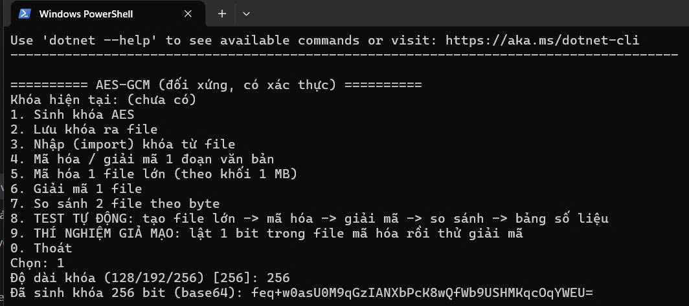

### 1.2 Lưu khóa ra file (menu 2)
Lưu khóa base64 vào `gcm.key`.

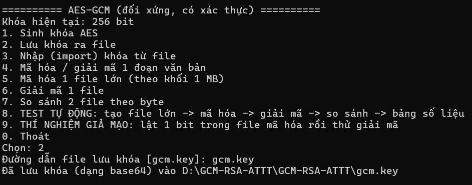

### 1.3 Nhập khóa từ file (menu 3)
Nhập `gcm.key` thành công, nhận đúng khóa 256 bit.

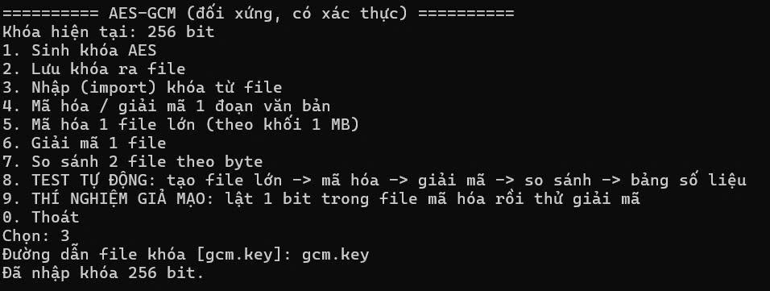

### 1.4 Mã hóa / giải mã văn bản tiếng Việt (menu 4)
Văn bản thử: `Bùi Duy Linh - K235480106041`. Kết quả là base64 của `nonce 12 byte | tag 16 byte | bản mã`; giải mã lại ra đúng văn bản gốc.

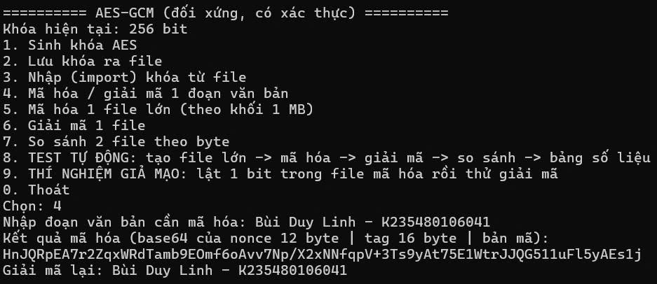

### 1.5 Mã hóa, giải mã, so sánh file `mau.txt` (menu 5, 6, 7)

| Bước | Kết quả (từ ảnh) |
|---|---|
| Mã hóa `mau.txt` → `mau.txt.sec` | 0,004 s |
| Giải mã `mau.txt.sec` → `mau.txt.sec.out` | 0,003 s |
| So sánh `mau.txt` và `mau.txt.sec.out` | GIỐNG HỆT nhau theo từng byte |

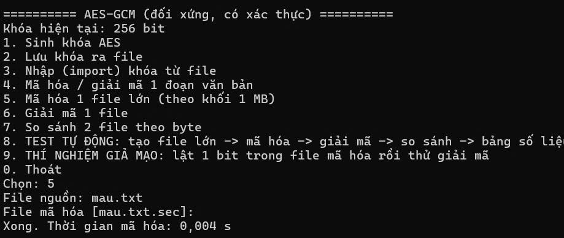
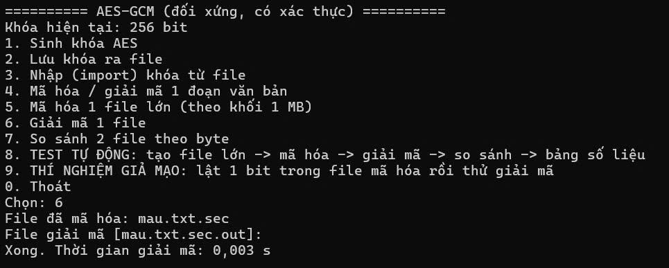
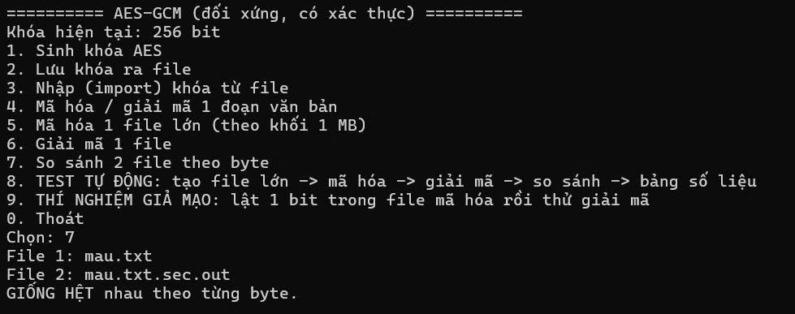

### 1.6 Đo hiệu năng file lớn (menu 8) và thí nghiệm giả mạo (menu 9)

> **Chưa có ảnh minh chứng.** Chạy menu 8 (10, 100, 500, 2000 MB) và menu 9 trên máy, chụp ảnh rồi điền bảng bên dưới. Không dùng số trong `reference/`.

| Kích thước (MB) | Mã hóa (s) | Giải mã (s) | Mã hóa (MB/s) | Giải mã (MB/s) | So sánh byte |
|---:|---:|---:|---:|---:|---|
| 10 | | | | | |
| 100 | | | | | |
| 500 | | | | | |
| 2000 | | | | | |

---

## Bài 2. RSA, SHA-512, chữ ký số (`RsaLab`)

| Menu | Chức năng |
|---|---|
| 1, 2 | Sinh cặp khóa RSA, xuất `pub_key.pem` (X.509 SPKI) và `priv_key.pem` (PKCS#8) |
| 3 | Xem PEM: base64 → DER, in cây ASN.1 và ý nghĩa từng byte |
| 4 | Nhập PEM, hiện n, e (và d, p, q, dP, dQ, qInv nếu là private key) |
| 5, 6 | Mã hóa / giải mã RSA-OAEP SHA-384, so sánh với dữ liệu gốc |
| 7 | Đo tốc độ mã hóa, giải mã, ký, xác minh theo độ dài khóa |
| 8 | SHA-512 và hiệu ứng thác đổ |
| 9 | Chữ ký số SHA-384: PKCS#1 v1.5, RSA-PSS, phương pháp nonce |

### 2.1 Sinh khóa và xuất PEM (menu 1, 2)
Sinh khóa RSA 2048 bit, e = 65537; xuất `pub_key.pem` và `priv_key.pem`.

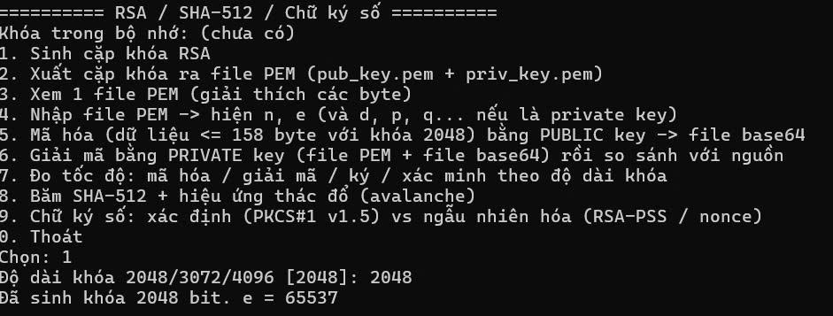
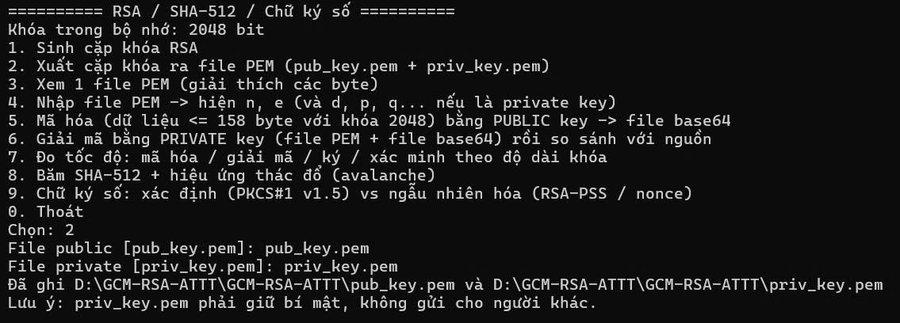

### 2.2 Xem PEM và cây ASN.1 (menu 3)
`pub_key.pem` là X.509 SubjectPublicKeyInfo, phần DER dài 294 byte (base64 dài 398 ký tự).

| Offset | Byte | Ý nghĩa |
|---:|---|---|
| 0 | `30 82 01 22` | SEQUENCE (290 byte) |
| 4 | `30 0D` | SEQUENCE (13 byte): AlgorithmIdentifier |
| 6 | `06 09` | OID 1.2.840.113549.1.1.1 (rsaEncryption) |
| 17 | `05 00` | NULL |
| 19 | `03 82 01 0F` | BIT STRING (271 byte) |
| 24 | `30 82 01 0A` | SEQUENCE (266 byte): RSAPublicKey |
| 28 | `02 82 01 01` | INTEGER (257 byte): n, 2048 bit |
| 289 | `02 03` | INTEGER (3 byte): e = 65537 (`010001`) |

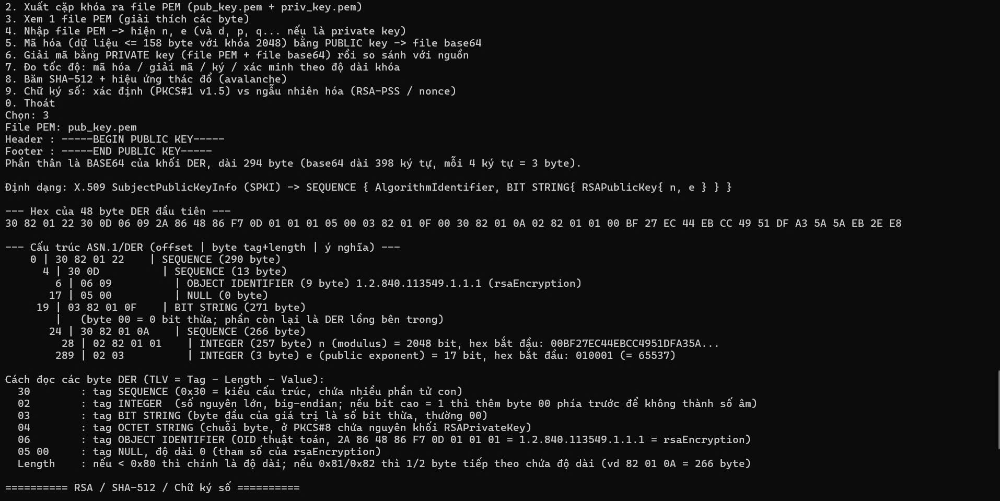

### 2.3 Nhập PEM, hiện n và e (menu 4)
Nhập `pub_key.pem`: khóa 2048 bit, e = 65537 (hex `010001`), hiển thị modulus n dạng hex; chương trình xác nhận đây là PUBLIC KEY (chỉ có n, e).

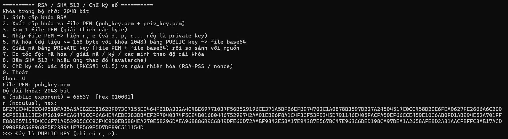

### 2.4 Mã hóa và giải mã RSA-OAEP SHA-384 (menu 5, 6)
Khóa 2048 bit cho phép dữ liệu tối đa `256 - 2×48 - 2 = 158` byte. Mã hóa một khóa AES-256 (32 byte) ngẫu nhiên, bản mã 256 byte lưu vào `ct.b64`. Giải mã bằng `priv_key.pem` được lại 32 byte, so sánh **GIỐNG HỆT** dữ liệu gốc. Hai lần mã hóa cùng dữ liệu cho bản mã khác nhau vì OAEP có seed ngẫu nhiên.

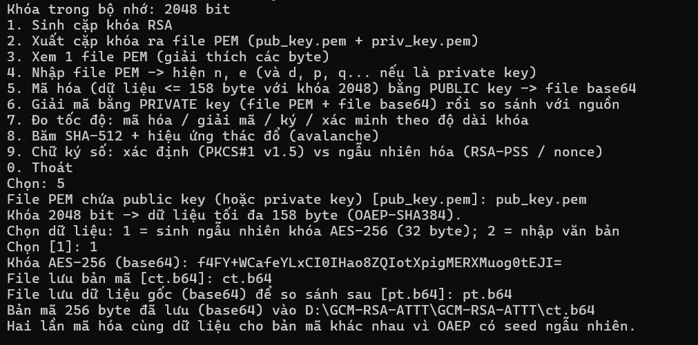
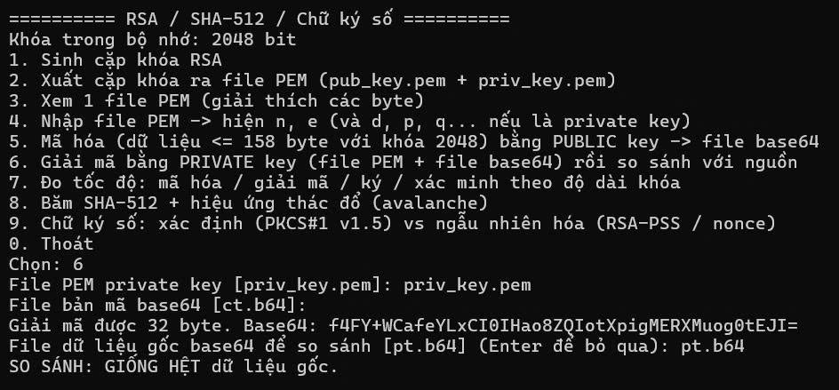

> Thử biên 158 và 159 byte: chưa có ảnh minh chứng.

### 2.5 Đo tốc độ (menu 7, 100 lần lặp mỗi phép)

| Khóa (bit) | e (bit) | d (bit) | Mã hóa (ms) | Giải mã (ms) | Ký (ms) | Xác minh (ms) | Giải mã / Mã hóa |
|---:|---:|---:|---:|---:|---:|---:|---:|
| 2048 | 17 | 2048 | 0,0396 | 0,9386 | 0,7109 | 0,0252 | 23,7 |
| 3072 | 17 | 3072 | 0,0782 | 2,3509 | 2,3399 | 0,0693 | 30,1 |
| 4096 | 17 | 4096 | 0,0720 | 5,1204 | 4,6953 | 0,0781 | 71,1 |

**Nhận xét:** khóa công khai có e = 65537 (17 bit) nên mã hóa và xác minh chỉ cần khoảng 17 phép bình phương modulo. Khóa bí mật có d xấp xỉ bằng n nên giải mã và ký chậm hơn nhiều lần, dù .NET đã dùng CRT với p, q. Khi tăng độ dài khóa, thời gian giải mã và ký tăng rất nhanh (2048 → 4096 bit: giải mã từ 0,94 ms lên 5,12 ms), còn mã hóa và xác minh gần như không đổi, nên tỉ lệ Giải mã / Mã hóa tăng từ 23,7 lên 71,1.

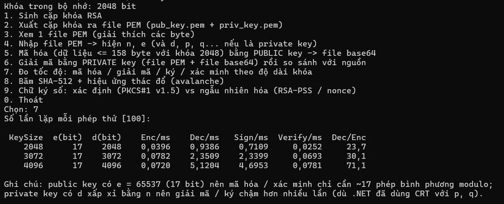

### 2.6 SHA-512 và hiệu ứng thác đổ (menu 8)

| Chuỗi nhập | Số bit khác so với lần băm trước |
|---|---|
| `Linhh liNhh liinHH` | (lần đầu) |
| `lin li LINH` | 250/512 bit (48,8%) |
| `Lyn lih liin` | 223/512 bit (43,6%) |

**Thí nghiệm đổi đúng 1 bit của đầu vào 128 byte, lặp 10000 lần:** số bit băm thay đổi trung bình **256,09/512 (50,02%)**, nhỏ nhất **209**, lớn nhất **297**. Chỉ đổi 1 bit đầu vào, khoảng một nửa số bit đầu ra bị đổi.

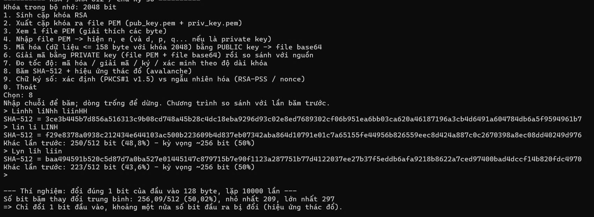

### 2.7 Chữ ký số SHA-384 (menu 9)
Dữ liệu ký: `Bui Duy Linh`, ký 5 lần bằng cùng private key.

| Phương pháp | Số chữ ký khác nhau / 5 lần | Xác minh đúng cả 5? |
|---|---:|---|
| PKCS#1 v1.5 + SHA-384 | 1 / 5 | Xác định, cùng một chữ ký |
| RSA-PSS + SHA-384 (salt ngẫu nhiên 48 byte) | 5 / 5 | Có (verify = True), sửa dữ liệu 1 bit thì verify = False |
| Nonce (ký SHA384(data ‖ nonce), gửi nonce kèm chữ ký) | 5 / 5 | Có (verify = True) |

**Đề xuất để chữ ký khác nhau mỗi lần:** dùng RSA-PSS (salt ngẫu nhiên trong mỗi lần ký, salt nằm trong chữ ký nên người nhận vẫn xác minh được bằng public key), hoặc ghép nonce ngẫu nhiên vào dữ liệu trước khi băm rồi gửi kèm nonce. PSS là chuẩn, có chứng minh an toàn và không cần giao thức phụ; phương pháp nonce đơn giản nhưng phải truyền thêm nonce và người nhận phải tự ghép lại đúng định dạng.

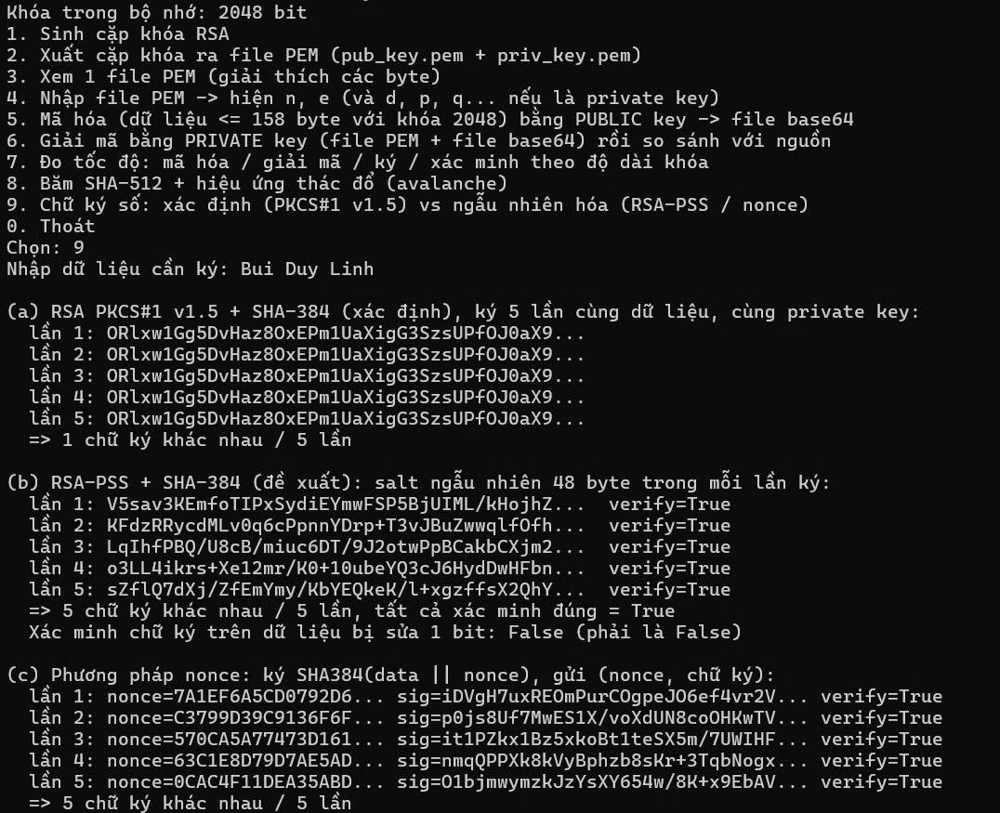

---

## Số liệu tham chiếu (Python)

File [`reference/ket_qua_tham_chieu.txt`](reference/ket_qua_tham_chieu.txt) chỉ dùng để đối chiếu thuật toán và định dạng file; số liệu đo trong báo cáo này là số đo trên máy của tôi (các ảnh ở trên).

## Lưu ý

Đây là bài tập học tập. Khóa AES-GCM không được dùng lại nonce với cùng một khóa; ứng dụng sinh nonce ngẫu nhiên 96 bit cho từng khối, đủ an toàn cho file cỡ GB, còn với khối lượng dữ liệu cực lớn nên đổi khóa định kỳ.
